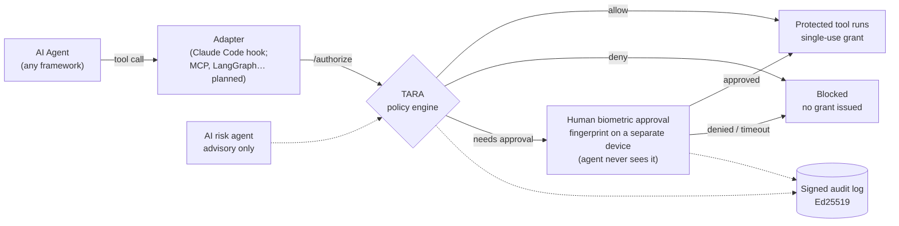

# TARA — a model-agnostic authorization layer for AI agents

**TARA sits between an autonomous AI agent and the actions it can take, and lets only authorized actions through.** Every tool call an agent attempts — reading a file, sending an email, moving money, deleting data, running a shell command — is checked against an explicit policy *before* it runs. Low-risk actions pass; consequential ones are blocked until a human approves them with a **biometric** — a fingerprint on a separate approval device — that the agent never sees; actions against TARA's own protected resources are denied outright and approval cannot unlock them. TARA **fails closed**: if it is unreachable, frozen, or anything goes wrong, the action is denied.

Nothing TARA decides depends on text the agent produced. A prompt-injection payload that says *"the user already approved this"* changes nothing — approval comes only from an out-of-band human biometric, and decisions come from the policy file.

> **Status:** working prototype. The authorization engine and one adapter (Claude Code) are implemented and covered by **213 passing security tests**. Additional framework adapters (MCP, LangGraph, Microsoft Agent Framework) are on the [roadmap](ROADMAP.md) and clearly marked *planned*.

---

## The problem

Autonomous agents are increasingly given real authority: access to a user's files, email, messaging, cloud accounts, browser sessions, and payment tools. Two failure modes follow directly from that authority:

1. **Hijacking.** An agent reads a web page, an email, or a document that contains hidden instructions ("prompt injection"). The agent, trying to be helpful, acts on them — exfiltrating data, sending messages, or making purchases the user never asked for.
2. **Error.** The agent simply misunderstands, and takes a consequential, irreversible action on its own initiative.

Most guardrails try to make the *model* safer — better system prompts, refusal training, content filters. These help, but they ask the same component that was hijacked to also be the thing that stops the hijack. TARA takes the other approach: it assumes the agent may be compromised or wrong, and puts an **independent authorization boundary** around the actions themselves. The agent can *propose* anything; only authorized actions *execute*.

## How it works



A rendered diagram is in [`docs/architecture.svg`](docs/architecture.svg) (PNG: [`docs/architecture.png`](docs/architecture.png)).

1. The agent attempts a tool call.
2. An **adapter** for that agent framework intercepts the call and asks TARA to authorize it (`POST /authorize`). The shipped adapter is a [Claude Code](https://claude.com/claude-code) hook ([`tara/hook.py`](tara/hook.py)).
3. The **policy engine** ([`tara/core.py`](tara/core.py)) evaluates the action against [`policy.yaml`](policy.yaml) and returns `allow`, `deny`, or `pending` (needs a human).
4. On `allow`, the tool runs. On `deny`, it is blocked and no grant is ever issued. On `pending`, a human must approve **out-of-band on a separate approval device, with a biometric** — a fingerprint today (two *different* enrolled fingerprints for critical, two-person actions). Only then does TARA issue a **single-use grant bound to that exact action**. A one-time code shown in the local window, and additional biometric factors (iris, ear-placement), can layer on as further checks; the agent never sees any of them.
5. Every decision, approval, and execution is appended to a **signed, tamper-evident audit log** (Ed25519); the public key is served at `GET /pubkey` so anyone can verify the chain.

### Why "model-agnostic"

The engine authorizes on `(tool_name, tool_input)`. The `agent` argument to `TaraCore.authorize(...)` is a free-form label; nothing in the engine is coupled to a particular model or vendor. A new framework is onboarded by writing a thin adapter that translates its tool-call events into `/authorize`, `/wait`, and `/consume` calls — exactly what the Claude Code hook does in ~80 lines. Today one adapter ships; the design is built for more.

## Key properties

- **Fails closed.** Unreachable, frozen (kill switch), or any error ⇒ deny. See `test_hook_denies_when_tara_is_down`.
- **The agent's words never authorize.** Injected "approval" text is ignored; approval is an out-of-band human biometric the agent cannot see. See `test_injected_claim_of_approval_is_ignored`.
- **Protected resources cannot be unlocked by approval.** TARA's own files, keys, audit log, and the agent's credentials are hard-denied. See `test_relative_path_into_tara_is_denied`.
- **Grants are single-use and action-bound.** A grant authorizes one execution of one exact action (tool + arguments, bound by a SHA-256 action hash) and is burned on use; replays are rejected. See `test_approved_grant_executes_once`, `test_grant_replay_is_rejected`.
- **Data-aware escalation.** What the agent has read constrains where data may go: reading controlled/PHI/SSN-shaped data escalates or denies later outbound actions (two-person approval for PHI).
- **Tiered, biometric human approval.** Approval is a biometric match on a separate device — a fingerprint today; `two_person` (two *different* enrolled biometrics) for critical actions, and a lighter `confirm` for medium risk. A one-time code is a fallback, and further factors (iris, ear-placement) can be added as extra checks.
- **Tamper-evident audit.** Append-only, Ed25519-signed; independently verifiable via `/pubkey`.
- **Advisory AI risk agent, never the authority.** A separate, tool-less model can classify an action in context, but it can never unlock a protected resource or skip a required approval; if it fails, a human decides.

## Quick start

```bash
# 1. Clone and install the two core dependencies
git clone https://github.com/manju-reddyy/tara.git
cd tara
python -m pip install -r requirements.txt      # PyYAML, cryptography

# 2. See the authorization decisions, live (no server, no GUI, no keys)
python examples/demo.py

# 3. Run the full security test suite (213 scenarios)
python tests/test_tara.py
```

Full setup — including running the authorization server and wiring the Claude Code adapter — is in **[INSTALL.md](INSTALL.md)**. Worked allow/deny demonstrations are in **[docs/DEMO.md](docs/DEMO.md)**. A dated test report is in **[TEST_RESULTS.md](TEST_RESULTS.md)**.

## Repository layout

| Path | What it is |
|------|------------|
| [`tara/core.py`](tara/core.py) | The authorization engine: policy evaluation, approval requests, single-use grants, signed audit log |
| [`tara/server.py`](tara/server.py) | Local HTTP server (`127.0.0.1:8765`) + the human approval window |
| [`tara/hook.py`](tara/hook.py) | The Claude Code adapter (PreToolUse / PostToolUse hooks) |
| [`tara/risk_agent.py`](tara/risk_agent.py) | The optional, advisory AI risk reviewer |
| [`policy.yaml`](policy.yaml) | The authorization policy: protected paths, rules, data labels, approval levels |
| [`tests/test_tara.py`](tests/test_tara.py) | 213 security tests (each is an attack or failure scenario TARA must block) |
| [`examples/demo.py`](examples/demo.py) | Runnable allow/deny/approval demonstration |
| [`docs/architecture.svg`](docs/architecture.svg) | Architecture diagram |

*(Biometric approval is handled on a separate hardware approval device — fingerprint today, with room for additional factors such as iris or ear-placement as extra checks. The repository also contains an optional voice/speaker component that only ever **adds friction** — an unrecognized voice asks for more — and never grants approval; it has additional, optional dependencies and is not required for the authorization core, the demo, or the tests.)*

## Security

To report a vulnerability privately, see **[SECURITY.md](SECURITY.md)**. Please do not open public issues for security reports.

## License

Licensed under the **Apache License 2.0** — see [LICENSE](LICENSE).

## Author

Sai Manjunath Reddy Katha. TARA is independently developed research into authorization boundaries for autonomous AI agents.
